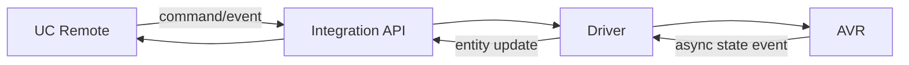
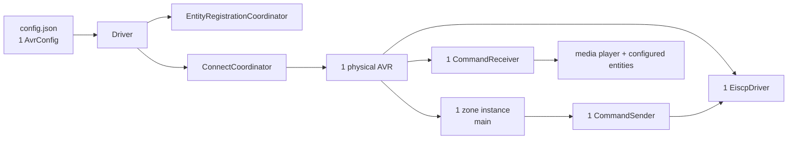
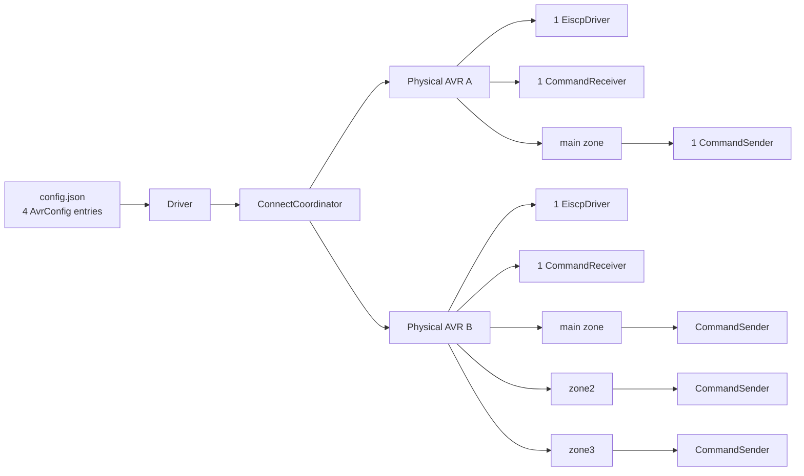
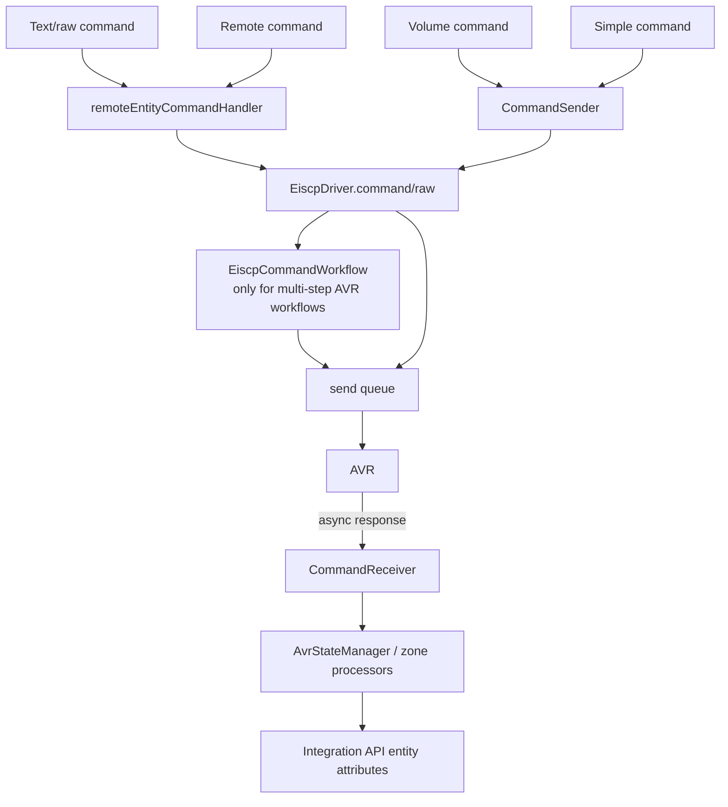
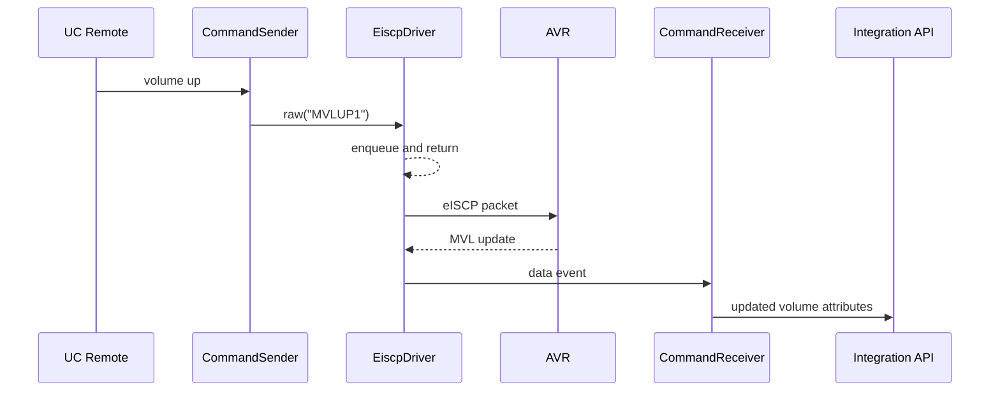

# Architecture

_this doc is generated_

This is an event-driven Unfolded Circle integration for Onkyo, Pioneer and Integra AVRs.

## Way of working

- First make it work; then iterate toward nicer implementations.
- Aim for the sweet spot between **SOLID** and **KISS**, while staying pragmatic.
- Perfect is the enemy of good.
- Prefer small, testable responsibilities, but do not create abstractions without a useful reason.

## Event-based setup

The integration does not wait for a response to complete normal commands.

Outbound commands are queued by `EiscpDriver`. Inbound AVR events are parsed, emitted as `data` events, and applied to entity state by `CommandReceiver` and its processors.

## Configuration and zones

### Schema

The persisted configuration is an `IntegrationConfig` containing an array of `AvrConfig` entries. Each entry represents one physical AVR and one zone.

The physical connection key is `model + ip`. Zone entity IDs additionally include `zone`.

### One AVR, one zone

### Two AVRs, four zones

One `EiscpDriver` and one `CommandReceiver` are created per physical AVR. `ConnectCoordinator` deduplicates physical connections, then creates one `AvrInstance` and one `CommandSender` per configured zone.

Therefore the one-zone example has **1 transport, 1 receiver and 1 sender**. The two-AVR example has **2 transports, 2 receivers and 4 senders**: one sender for AVR A and three senders for AVR B.

## Command flow

Volume, simple commands, text commands and remote commands converge on the same eISCP transport path. The entry adapter differs; the AVR connection and event path do not.

### Asynchronous volume example

The command result means that the command was accepted or queued. The authoritative volume value comes from the AVR's later state event.

## Layers and main classes

### Platform / application layer

- `Driver` — integration entry point and lifecycle orchestration.
- `SetupHandler` — setup UI and configuration flow.
- `EntityRegistrationCoordinator` — applies entity-registration policy.
- `EntityRegistrar` — builds media players, sensors, selects and remotes.

### Connection / infrastructure layer

- `ConnectCoordinator` — creates physical connections and zone instances.
- `ConnectionManager` — owns physical AVR connections.
- `ReconnectionManager` — retry and backoff scheduling.
- `SetupInputSourceProbe` — temporary setup-time discovery/NRI connection.
- `EiscpDriver` — TCP/UDP transport, framing, queues and lifecycle events.

### Domain / application behavior layer

- `CommandSender` — standard media-player command adapter.
- `remoteEntityCommandHandler` — remote and text-command adapter.
- `CommandReceiver` — inbound event dispatcher.
- `ZoneAgnosticUpdateProcessor` — routes events shared across zones.
- `AvrStateManager` — per-zone state and entity-state projection.
- `EiscpCommandWorkflow` — TuneIn and network-service multi-command workflows.
- `PlayMediaCommandHandler` — media-service playback decisions.

### Protocol / pure-function layer

- `eiscp-packet.ts` — eISCP frame encoding and extraction.
- `eiscp-command-parser.ts` — raw command parsing and state mapping.
- `eiscp-mappings.ts` / `eiscp-commands.ts` — command and value definitions.
- `zoneMappings.ts` — zone-specific command prefixes.
- `audioFormatClassifier.ts`, `menuEntryParser.ts`, `eiscp-multi-zone.ts` — isolated parsing and transformation helpers.

### State and service modules

- `avrInfoStore`, `inputSourceStore`, `tunerPresetStore` — learned AVR data.
- TuneIn, Tidal, Deezer and Music Server browser modules — service-specific browsing state and behavior.
- `ZoneAgnosticMediaStateStore` and `ZoneMediaRenderer` — shared playback metadata and artwork.

The intended dependency direction is: platform/application → connection/domain behavior → transport/protocol, with pure functions kept independent wherever practical.
