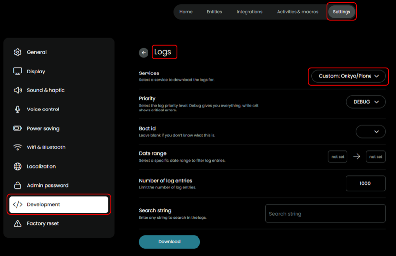

## Collect logs

- Reconfigure the integration: `Log level = Debug (all)`
    

- Complete the setup flow of the integration so the configuration change takes effect
- Turn off AVR
- Turn on AVR
- Perform the action for which you need the logs
- Browse to Settings > Development > Logs
- Services: `Custom: Onkyo/Pioneer/Integra AVR`
- Download

    

- Reconfigure the integration: `Log level = Warn + Error (default)`
    
