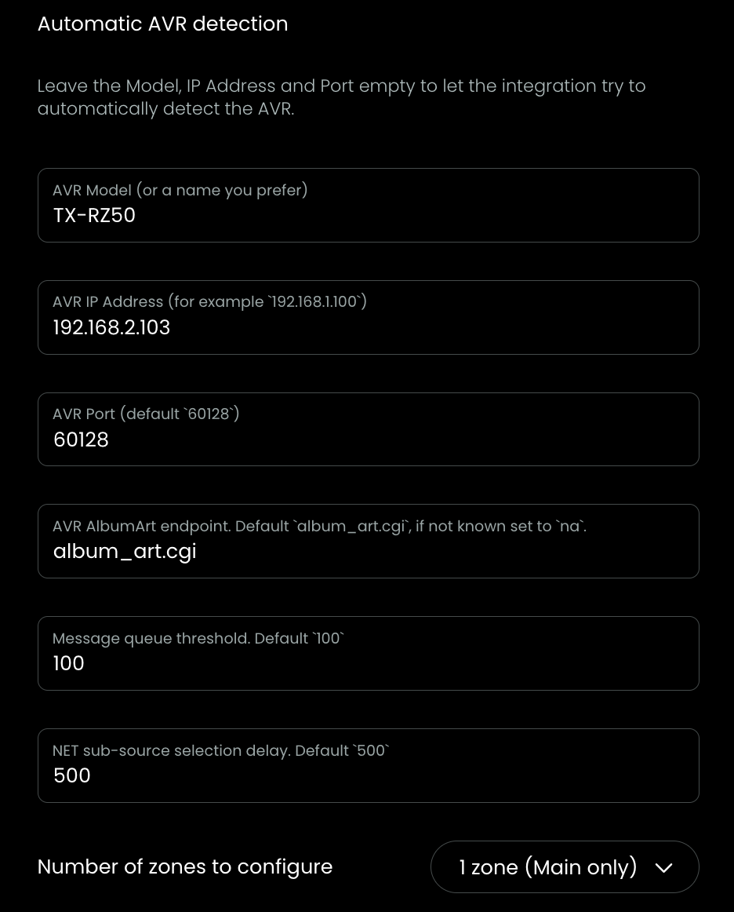
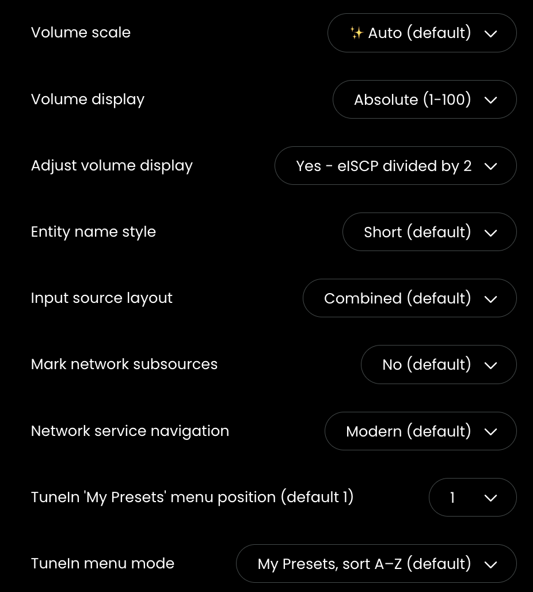
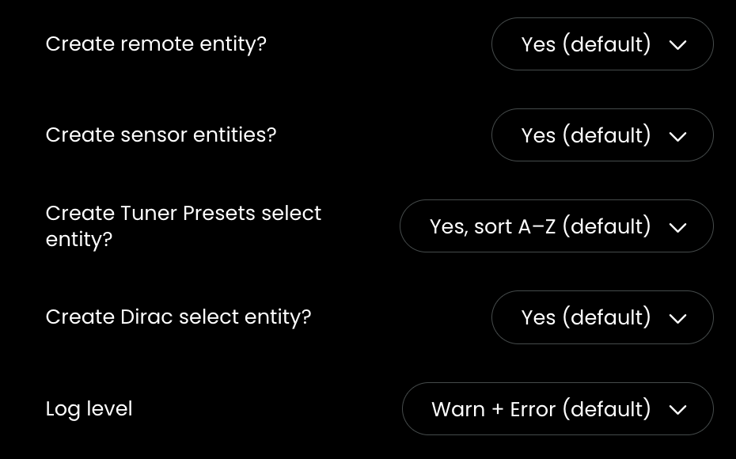
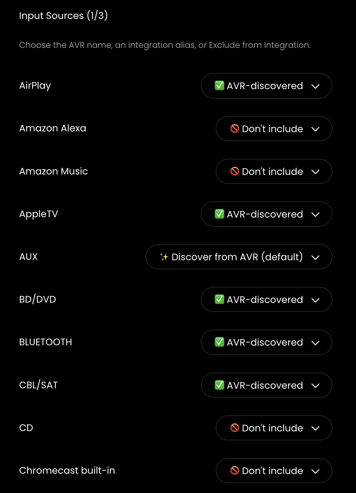
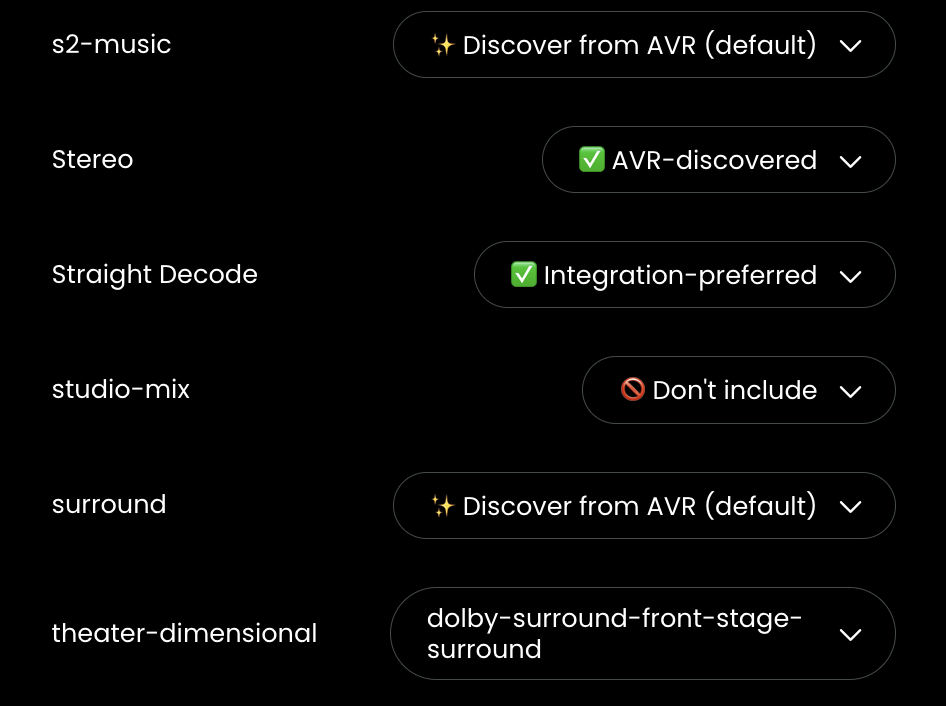

# Configuration

You can reconfigure the integration at any time, in Web Configurator, goto `Integrations` and select this integration, then click Install.

You can select which specific part you want to reconfigure.

## Integration

### Integration, page 1
- `AVR Model` and `AVR IP Address` can be left empty to auto-discover your AVR (older models might need manual input)
- see [AlbumArt](album-art.md) for more info about `AVR AlbumArt` endpoint
- if the integration is does not always behave reliably you can set the defaul delay values higher to find the sweet spot for your model
- select the correct number of zones you are using

### Integration, page 2
- `Volume`: see [Volume](volume.md) for more info
- `Entity name style`: show IP Address in entity names
- `Input source layout`: show the Network sources separate from other sources or combined
- `Mark network subsources`: select an Icon to [mark](mark-network.md) the Network sources 
- `Network service navigation`: if MediaBrowser for TuneIn, MusicServer, Tidal, Deezer is not working in `Modern` mode, try `Legacy` mode instead (navigates a bit slower)
- `TuneIn MyPresets`: see [TuneIn](tunein.md) for more info
- `TuneIn menu mode`: set how MediaBrowser offers the content

### Integration, page 3
- select which entities you want to have created by this integration

## Input Sources

The integration is now able to collect the exact names that your specific AVR is using. It can however only learn that name that kind of reporting is supported by your AVR. So, with inital install of v1.0.0 all input sources known by this integration are set to `✨ Discover from AVR`. When your AVR reports its own dialect of that specific input source, this integration will learn it, and status changes to `✅ AVR-discovered` and from now on use that name instead of one of the aliases. You can change this behavior by selecting the alias you prefer. You can also `🚫 Don't include` aan input source if you never use it anyway. Then the list of input sources in the select-entity will be shorter.

There will be multiple pages to cover for all the known Input Sources. See [Input Selector](input-selector.md) for more info.

## Listening Modes

The integration is now able to learn the exact names that your specific AVR is using. It can however only learn that name when its reported by your AVR. So, with inital install of v1.0.0 all listening modes known by this integration are set to `✨ Discover from AVR`. When your AVR reports its own dialect of that specific listening mode, this integration will learn it, and status changes to `✅ AVR-discovered` and from now on use that name instead of one of the aliases. You can change this behavior by selecting the alias you prefer. You can also `🚫 Don't include` a listening mode if you never use it anyway. Then the list of listening modes in the select-entity will be shorter.

For most AVRs, `Straight Decode` triggers the AVR to select a setting, which does not send out a specific name for Straight Decode. So a name will probably never be learned, thats why for Straight Decome de default setting is `Integration-preferred`. Basically to not be the only name shown as the known alias straight-decode.

For some codes used by the AVR, it depends on source and audio format which name is used. The integration stores all that info and can like that use the specific name used for a specific situation. So now, even when for example `Dolby Atmos` is not known by this integration default listening modes, after your AVR has been playing Dolby Atmos, you can select that listening mode later directly again when the AVR is playing that audio format.

There will be multiple pages to cover for all the known Listening Modes. See [Listening Modes](listening-modes.md) for more info.