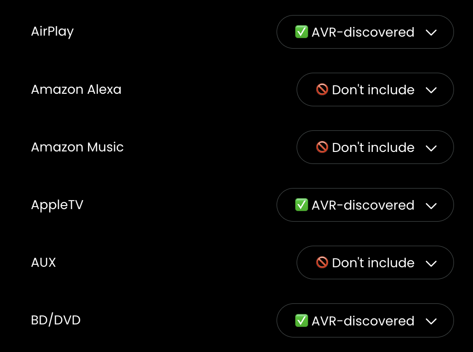

## Input source

### Select source from dropdown

The `Input source` command offers a dropdown list [based on your config](./source-webconfigurator-mediawidget.md), so depending on how you configured [Input Select](./select-input-selector.md) the integration will show a list of input sources. By default AVR-reported names and IDs are used when available.

Input sources are configured per physical AVR and apply to all of that AVR's configured zones. During setup, choose **Configure input sources**. If more than one AVR is configured, setup first asks which AVR to configure.

After upgrading to version 0.9.9, configure the input sources once for each AVR so you can choose which sources to include and which names to display.

## AVR specific names
The integration is now able to collect the exact names that your specific AVR is using. It can however only learn that name that kind of reporting is supported by your AVR. So, with inital install of v0.9.9. all input sources known by this integration are set to `✨ Discover from AVR`. When your AVR reports its own dialect of that specific input source, this integration will learn it, and status changes to `✅ AVR-discovered` and from now on use that name instead of one of the aliases. You can change this behavior by selecting the alias you prefer. You can also `🚫 Don't include` aan input source if you never use it anyway. Then the list of linput sources in the select-entity will be shorter.

### NET

`NET` covers multiple options, for example streaming Spotify/Deezer/Tidal to your AVR. So when you want to stream Spotify/Tidal/... you can select `net` as Input source and then hit play on your Spotify/Deezer app and select your AVR. Later on, when you select your NET activity again and hit play on the remote, the AVR will try to continue where you left it last time it was playing from NET.

### Select Spotify/Deezer/... directly

As from v0.7.3 you can select the 'sub-sources'of `NET` directly, let's say you want the AVR to switch to TuneIn, you can select `tunein` as Input source and the integration will make sure that _first_ the command is send to switch to `NET` and then a _second_ command is send to select `TuneIn` as the sub-source in NET. After switching to `NET` your AVR might need a few moments to setup, the next command is send with a delay **automatically** which you can configure during setup:

For the following sources, the integration will first send the `input-selector net` command automatically _before_ sending the second command for switching to the sub-source:

- TuneIn
- Spotify
- Deezer
- Tidal
- AmazonMusic
- Chromecast
- DTS-Play-Fi
- AirPlay
- Alexa
- Music-Server

_Your AVR must support these services. Check the manual of your model to see which of these services / inputs are available. Another way to check is to use the Onkyo app and see if you can switch the AVR to such a source, if it can then this integration should also be able to do that._

_If a service like Spotify is not a selectable input source on your AVR, just use `net` as Input source as mentioned above and then send music from your Spotify/Tidal/... app._

[more on how to send different commands through `Input source`](./cheats.md)

[activities examples](../README.md#install)
