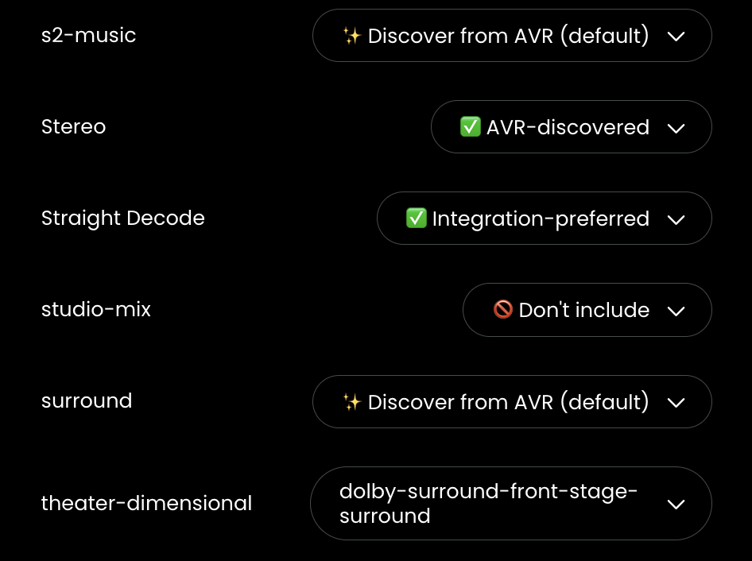
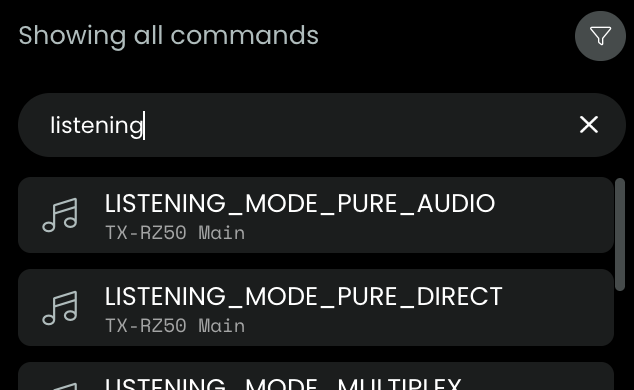

## Listening modes

Listening modes are configured per physical AVR and apply to all configured zones of that AVR. If more than one AVR is configured, setup asks which AVR should be configured.

The integration can discover AVR-specific listening-mode names and codes. Use **Discover from AVR** to obtain a name when the relevant input and audio format are active. Once the AVR-specific name has been learned, it is shown as **AVR-discovered**. This also allows listening modes that are not part of the integration's built-in command mappings to be configured and selected.

After upgrading to version 0.9.9, configure the listening modes once for each AVR if you want to change the defaults.

## AVR specific names
Since v0.9.9, the integration is able to learn the exact names that your specific AVR is using. It can however only learn that name once it has been reported by your AVR. So, with inital install of v0.9.9. all listening modes known by this integration are set to `✨ Discover from AVR`. When your AVR reports its own dialect of that specific listening mode, this integration will learn it, and status changes to `✅ AVR-discovered` and from now on use that name instead of on of the aliases. You can change this behavior by selecting the alias you prefer. You can also `🚫 Don't include` a listening mode if you never use it anyway. Then the list of listening modes in the select-entity will be shorter.

For most AVRs, `Straight Decode` triggers the AVR to select a setting, which does not send out a specific name for Straight Decode. So a name will probably never be learned, thats why for Straight Decome de default setting is `Integration-preferred`. Basically to not be the only name shown as the known alias straight-decode.

For some codes used by the AVR, it depends on source and audio format which name is used. The integration stores all that info and can like that use the specific name used for a specific situation. So now, even when for example `Dolby Atmos` is not known by this integration default listening modes, after your AVR has been playing Dolby Atmos, you can select that listening mode later directly again when the AVR is playing that audio format.

## Select from list

As from v0.9.0 listening modes are available as so called [simple commands](generated-simplecommands.md):

## What about `Dolby Atmos`, `DTS:X`, `Auro-3D`, `IMAX Enhanced`?

eISCP codes for Atmos, DTS:X, Auro-3D, and IMAX Enhanced are not standardized and may vary by receiver model and firmware.

However, most models `auto-select` the correct mode when the input signal is `Dolby Atmos`, `DTS:X`, `Auro-3D`, `IMAX Enhanced` and the listening mode is set to `Straight Decode`.

| Listening mode | Setup           |
| -------------- | --------------- |
| Dolby Atmos    | straight-decode |
| DTS:X          | straight-decode |
| Auro-3D        | straight-decode |
| IMAX Enhanced  | straight-decode |

## Select widget

As from version 0.8.0, the integration offers a `select` widget for listening modes, see [this doc](select-listening-mode.md).

Different models sometimes use different names for a single listening mode.

## Example of known Pioneer listening modes

| Listening modes known to be accepted by Pioneer |
| ----------------------------------------------- |
| direct                                          |
| dolby-surround                                  |
| dolby-surround-classical                        |
| dolby-surround-drama                            |
| dolby-surround-entertainment-show               |
| dolby-surround-front-stage-surround             |
| dolby-surround-sports                           |
| dolby-surround-unplugged                        |
| dts-neural:x                                    |
| extended-mono                                   |
| extended-stereo                                 |
| mono                                            |
| pure-direct                                     |
| stereo                                          |
