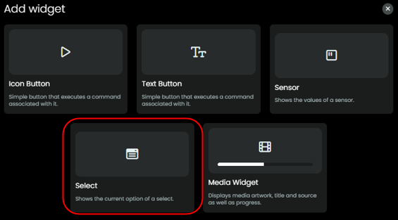

# Select Input Selector

The integration provides a select entity for the AVR's input selector.

The available input sources are based on the selected AVR. Sources reported by the AVR are shown using the AVR's own names and IDs whenever possible. This also allows sources that are not present in the integration's built-in mappings to be used.

## Configure input sources

After initial setup, choose **Configure input sources** in the integration setup. If more than one physical AVR is configured, setup first asks which AVR to configure. The settings apply to all configured zones of that AVR; zones are not configured separately.

For each reported input source, choose one of:

- **✨ Discover from AVR** — use the name reported by the AVR when it is available.
- **✅ AVR-discovered** — use the name that has already been learned from the AVR.
- An integration alias — use a standard integration name instead.
- **🚫 Don't include** — hide the source from the selector.

The AVR-reported input list is collected when the AVR provides its information data. If the AVR does not report usable input information, the integration falls back to its built-in mappings.

The collected AVR input list is runtime data. The per-source preferences are saved in the configuration and are included in backups.

## Input source names in the Remote

The configured list affects both the `input-selector` select entity and the `Input source` list available when configuring a media player entity in the Web Configurator.

[How this selector impacts the Remote](./source-webconfigurator-mediawidget.md)
